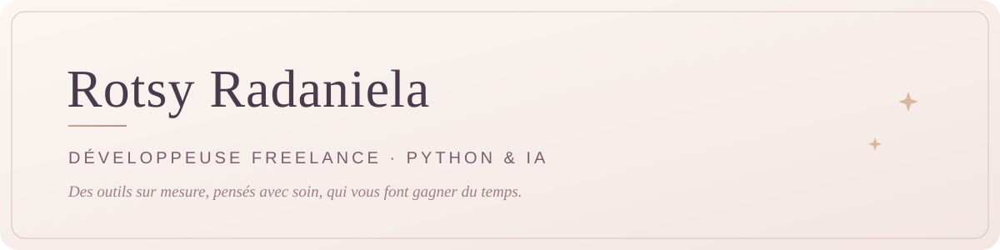

  

  
  
  
  

 

  <i>Élève ingénieure en aéronautique, je conçois des outils numériques élégants et fiables : 
  du script qui automatise vos tâches répétitives à l'assistant IA qui exploite vos documents.</i>

Missions à distance · Île-de-France · Français & anglais

 

<h2 align="center">✦ &nbsp;Services&nbsp; ✦</h2>

<table align="center">
  <tr>
    <td width="50%" valign="top">
      <h4>Automatisation</h4>
      Scripts Python, traitement de fichiers Excel / CSV, extraction de données, intégrations entre vos outils.
        
      <i>Démo sur demande</i>
    </td>
    <td width="50%" valign="top">
      <h4>Assistants IA</h4>
      Un assistant qui répond à partir de vos PDF, manuels ou procédures (RAG, API OpenAI / Claude).
        
      <a href="LIEN_DEMO_DOC_AERO">Voir la démo DOC AERO →</a>
    </td>
  </tr>
  <tr>
    <td width="50%" valign="top">
      <h4>Extensions Chrome</h4>
      Conception, développement et publication d'extensions de navigateur sur mesure.
        
      <a href="https://bloomie-one.vercel.app">Voir la démo Bloomie →</a>
    </td>
    <td width="50%" valign="top">
      <h4>Applications web</h4>
      Pages vitrines, prototypes et interfaces React soignées et responsives.
        
      <a href="LIEN_DEMO_ECHOES">Voir la démo Echoes →</a>
    </td>
  </tr>
</table>

Devis détaillé avant démarrage &nbsp;·&nbsp; Points d'avancement réguliers &nbsp;·&nbsp; Livraison documentée et vidéo de démonstration

 

<h2 align="center">✦ &nbsp;Réalisations&nbsp; ✦</h2>

<table align="center">
  <tr>
    <td width="50%" valign="top">
      <!-- Capture :  -->
      <h4>DOC AERO</h4>
      Assistant IA qui répond aux questions à partir de manuels techniques aéronautiques, en citant ses sources.
        
      
      
      
       
      <a href="LIEN_DEMO_DOC_AERO">Démo →</a>
    </td>
    <td width="50%" valign="top">
      <!-- Capture :  -->
      <h4>Echoes</h4>
      Plateforme de préservation des langues du monde : globe interactif et transcription automatique d'enregistrements audio.
        
      
      
      
       
      <a href="LIEN_DEMO_ECHOES">Démo →</a>
    </td>
  </tr>
  <tr>
    <td width="50%" valign="top">
      <!-- Capture :  -->
      <h4>Bloomie</h4>
      To-do list qui bloque les sites distrayants jusqu'à ce que les tâches soient terminées, et fait fleurir un jardin virtuel.
        
      
      
      
       
      <a href="https://bloomie-one.vercel.app">Démo →</a>
    </td>
    <td width="50%" valign="top">
      <!-- Capture :  -->
      <h4>Avionique de mini-fusée</h4>
      Système embarqué d'une fusée larguée depuis un drone : détection de l'apogée, déploiement du parachute, télémétrie en vol.
        
      
      
      
       
      <a href="https://github.com/rotsy05/airlaunched-mini-rocket">Projet →</a>
    </td>
  </tr>
</table>

 

<h2 align="center">✦ &nbsp;Boîte à outils&nbsp; ✦</h2>

  
  
  
  
  
  
  
  
  
  

 

  <b>Un projet en tête ?</b> 
  <i>Parlons-en, je réponds sous 24 h.</i>
    
  

